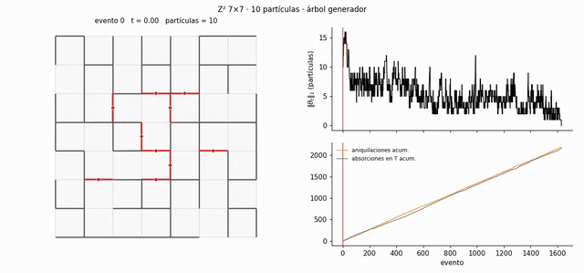
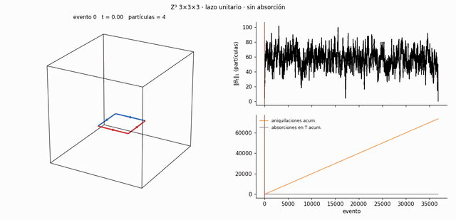

# Proceso de ramificación en complejos celulares

Simulación estocástica de un sistema de partículas con **ramificación y aniquilación** sobre el complejo cúbico $\mathbb{Z}^d$, restringido a una caja finita. Proyecto del curso **Simulación Estocástica** (Ingeniería Civil Matemática, Universidad de Chile, Primavera 2026) en conjunto con Bruno Guevara, basado en el trabajo en preparación *Branching process on complexes* de D. Cid y A. Sepúlveda.

<p align="center">
  
  
</p>

## El modelo

Una configuración $\theta \in \mathbb{Z}^{E^+}$ asigna a cada arista una cantidad entera de partículas con signo. En cada evento, una partícula sobre la arista $e$ elige una cara $f$ que la contiene: la partícula se aniquila y nacen partículas en el resto del borde de $f$,

$$\theta \longmapsto \theta - \langle e, \partial f\rangle \text{sgn}(\theta_e)\, \partial f .$$

Las partículas de signo opuesto que caen en una misma arista se aniquilan, y las que llegan a un conjunto absorbente $T$ mueren. El generador cumple $\mathcal{L} I(\theta) = -\Delta_1^{\uparrow}\theta$, donde $\Delta_1^{\uparrow}$ es el Laplaciano de Hodge superior.

## Qué hace el notebook

1. **Complejo cúbico y operadores.** Construye vértices, aristas y caras de la caja $[0,n_1]\times\cdots\times[0,n_d]$ en coordenadas dobladas (solo enteros), para cualquier dimensión $d$. Arma $\partial_1$, $\partial_2$ y $\Delta_1 = \Delta_1^{\downarrow} + \Delta_1^{\uparrow}$ como matrices dispersas (SciPy).
2. **Condiciones de absorción.** Absorción en un árbol generador (el caso del paper), en el borde de la caja o sin absorción. Incluye un árbol generador que evita la condición inicial.
3. **Motor estocástico.** Simulación exacta en tiempo continuo (algoritmo de Gillespie), con actualizaciones locales $O(1)$ y registro de la trayectoria independiente del tamaño de la caja.
4. **Configuraciones iniciales y reconstrucción** de la trayectoria a partir del proceso de alturas.
5. **Visualización** en 2D y 3D.
6. **Réplicas, condiciones iniciales y absorción.** Réplicas reproducibles en paralelo (`joblib`), el lazo unitario $\partial f$, $N$ partículas al azar, y conjuntos absorbentes (ninguno, árbol generador, o las primeras $k$ aristas de un orden de agregación).
7. **Videos** en $\mathbb{Z}^2$ y $\mathbb{Z}^3$ (ver abajo).
8. **Probabilidad de extinción según el número de aristas absorbentes.** Se agregan aristas al conjunto absorbente $T$ con distintas reglas (uniforme, árbol aleatorio y BFS desde el centro), tanto como familia fija $T_0\subset T_1\subset\cdots$ como creciendo durante la simulación, en cajas $9\times9$ y $9\times9\times9$. Resultados principales:
   - **Cargas conservadas.** Para cada componente $C$ del grafo $(V,T)$, la carga $Q_C=\sum_{v\in C}(\partial_1\theta)(v)$ se conserva. La extinción es posible si y solo si todas son nulas, lo que se verificó sin excepciones en 2400 simulaciones. La probabilidad de extinción *eventual* resulta un problema de conectividad (percolación) del grafo $(V,T)$, se calcula exactamente y es monótona en $T$.
   - **La extinción en tiempo finito no es monótona.** Para el lazo, agregar aristas absorbentes la hace más lenta, y que $T$ crezca más rápido también, porque cortar el lazo impide que se aniquile solo.
   - **En $\mathbb{Z}^3$** la extinción temprana se satura en $\approx 0.3$–$0.4$ aunque la extinción eventual sea segura: el resto escapa a una meseta de cientos de partículas.

Las verificaciones de la teoría ($\partial\partial=0$, el drift $-\Delta^{\uparrow}\theta$, la cota de Lyapunov del Teorema 2.1 y Poincaré) y la explicación detallada del código están en el documento de explicación (PDF).

## Videos

| Video | Caja | Condición inicial | Absorción |
|---|---|---|---|
| [`z2_lazo_sin_arbol.mp4`](videos/z2_lazo_sin_arbol.mp4) | $7\times7$ | lazo unitario $\partial f$ | ninguna (hasta la extinción) |
| [`z2_lazo_con_arbol.mp4`](videos/z2_lazo_con_arbol.mp4) | $7\times7$ | lazo unitario $\partial f$ | árbol generador (hasta la extinción) |
| [`z2_10particulas_arbol.mp4`](videos/z2_10particulas_arbol.mp4) | $7\times7$ | 10 partículas $+1$ | árbol generador (hasta la extinción) |
| [`z3_10particulas_arbol_meseta.mp4`](videos/z3_10particulas_arbol_meseta.mp4) | $7\times7\times7$ | 10 partículas $+1$ | árbol generador (crecimiento y meseta) |
| [`z3_lazo_sin_arbol.mp4`](videos/z3_lazo_sin_arbol.mp4) | $3\times3\times3$ | lazo unitario $\partial f$ | ninguna (hasta la extinción) |
| [`z3_lazo_con_arbol.mp4`](videos/z3_lazo_con_arbol.mp4) | $3\times3\times3$ | lazo unitario $\partial f$ | árbol generador (hasta la extinción) |
| [`meme_cruz_giratoria.mp4`](videos/meme_cruz_giratoria.mp4) ([GIF](videos/meme_cruz_giratoria.gif)) | $14\times14$ | cruz de aristas que gira | animación ilustrativa, no es una simulación |
| [`meme_anillo_oscilante.mp4`](videos/meme_anillo_oscilante.mp4) ([GIF](videos/meme_anillo_oscilante.gif)) | $15\times15$ | anillo $\partial_2(\text{disco})$ que se encoge hasta el lazo $\partial f$ y vuelve a crecer | animación ilustrativa, no es una simulación |

Los árboles generadores (conjunto absorbente) se dibujan en verde pálido. En los videos de lazo se muestra, con una regla fija, la primera réplica que se ramifica y después se extingue. En $\mathbb{Z}^3$ la extinción después de ramificarse solo se alcanza a observar en cajas muy pequeñas; en $7\times7\times7$ el proceso queda en una meseta de cientos de partículas.

## Cómo ejecutarlo

```bash
pip install numpy scipy matplotlib joblib jupyter
jupyter notebook branching_process_complexes.ipynb
```

Para generar los videos se necesita además `ffmpeg`.

## Referencias

- D. Cid, A. Sepúlveda. *Branching process on complexes*, borrador (2026).


**Autores:** Martín Maturana Acevedo y Bruno Guevara
